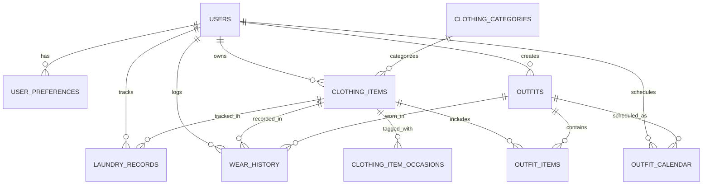

# MyWardrobe — Architectural Blueprint & System Design

> **Product Tagline**: *"Your Wardrobe. Your Style. Your Everyday."*  
> **Repository**: `shopsphere-digital-wardrobe` / `MyWardrobe`

---

## 1. UI/UX Analysis of the Reference Interface

The reference visual (`ELEVN - Create a Fashion Vibe`) presents an elevated, minimalist Scandinavian-Japanese fashion aesthetic. Key visual traits and how they map to our personal digital wardrobe application:

* **Warm Neutral Color Palette**:
  * Backgrounds: Warm stone and off-white (`#F7F7F5`, `#FAF9F7`, surface `#FFFFFF`).
  * Text & Accents: Deep charcoal/slate typography (`#1C1C1C`), subtle muted text (`#767676`).
  * Borders & Dividers: Ultra-soft warm grey borders (`#E8E6E1`).
  * Status Colors: Forest sage for available/clean (`#4E7A5A`), terracotta for laundry/unavailable (`#C45151`), champagne gold for high compatibility scores (`#C49E5A`).
* **Grid & Card Anatomy**:
  * Clean clothing photography centered on warm neutral backplates.
  * Rounded cards (`border-radius: 14px - 18px`) with soft ambient drop-shadows.
  * Direct action buttons on cards (mapped from "Add to Cart" to wardrobe actions: "Add to Outfit", "Quick Log Wear", "Favorite Toggle", "Care Status").
* **Editorial & Lookbook Hierarchy**:
  * Editorial typography combining bold sans-serif headings (`Inter` / `Outfit`) with spacious letter-spacing.
  * Capsule / Moodboard sections seamlessly showing outfit combinations instead of isolated items.
* **Responsive Paradigm**:
  * **Mobile**: Bottom navigation bar with 4 primary destinations (Closet, AI Outfits, Calendar, Home), with a center floating `+` Quick-Action button for Adding Clothes, Creating Outfits, and Scheduling Plans.
  * **Desktop**: Sophisticated sidebar navigation with brand mark, expansive closet grids, side-by-side outfit studio canvas, and rich analytics widgets.

---

## 2. Core Feature & Module Breakdown

| # | Module | Core Capabilities |
|---|---|---|
| **1** | **Dashboard & Home** | Personalized greeting ("Good morning, Alex"), Today's planned outfit preview, wardrobe quick-metrics (items, outfits, favorites, upcoming plans), recently added items, dynamic outfit suggestions. |
| **2** | **My Digital Closet** | Category filtering (T-Shirts, Shirts, Jeans, Jackets, Shoes, Accessories, etc.), search by name/tags, sort by recently added/worn/price, grid/list view toggle, active filter badges. |
| **3** | **Clothing Item Management** | Multipart photo upload, client/server file validation, metadata capture (brand, fabric, season, occasions, purchase price, care notes, status), favorite toggle, laundry status toggle. |
| **4** | **Outfit Studio** | Interactive canvas combining Tops, Bottoms, Outerwear, Shoes, and Accessories. Search and pick from wardrobe, preview collage, season/occasion tagging, duplicate & save looks. |
| **5** | **AI Outfits Engine** | Rule-based recommendation engine in Java Spring Boot. Evaluates occasion, season, palette harmony, and availability with transparent compatibility scoring (0-100%) and explainable stylist notes. |
| **6** | **Outfit Calendar** | Interactive month-grid calendar with real date navigation, occasion color tags, day detail view, schedule/reschedule/unschedule outfits, prevents conflicting plans. |
| **7** | **Wardrobe Analytics** | Visual charts (Recharts) for category distribution, color palette breakdown, wear frequency over time, and automated Cost-Per-Wear (CPW) calculations. |
| **8** | **Laundry & Clothing Care** | Tracking states (`AVAILABLE`, `IN_LAUNDRY`, `DRY_CLEANING`, `ARCHIVED`), care instructions, last-worn and last-cleaned timestamps, quick "Mark Clean" actions. |
| **9** | **User Profile & Preferences** | Custom style aesthetic, favorite color palettes, default sizing, preferred occasions, secure password updates. |
| **10** | **Authentication & Security** | JWT-based authentication, Spring Security 6 filter chain, BCrypt password hashing, role-based authorization, strict multi-tenant user data isolation. |

---

## 3. Database Schema & Entity Relationships

The schema is fully normalized and hosted in **MySQL 8.0** (`mywardrobe_db`):



### Table Definitions:
1. `users`: `id` (PK, BIGINT auto_inc), `full_name` (VARCHAR), `email` (VARCHAR unique), `password_hash` (VARCHAR), `role` (VARCHAR), `avatar_url`, `created_at`, `updated_at`.
2. `user_preferences`: `id` (PK), `user_id` (FK), `preferred_styles` (JSON/VARCHAR), `preferred_colours` (JSON/VARCHAR), `preferred_occasions` (JSON/VARCHAR), `created_at`, `updated_at`.
3. `clothing_categories`: `id` (PK), `name` (VARCHAR unique), `code` (VARCHAR unique), `display_order` (INT), `description` (TEXT).
4. `clothing_items`: `id` (PK), `user_id` (FK), `category_id` (FK), `name`, `image_path`, `primary_colour`, `secondary_colour`, `pattern`, `brand`, `fabric`, `season`, `style`, `purchase_date`, `purchase_price` (DECIMAL(10,2)), `availability_status` (`AVAILABLE`, `IN_LAUNDRY`, `UNAVAILABLE`), `is_favourite` (BOOLEAN), `washing_instructions`, `notes`, `created_at`, `updated_at`.
5. `clothing_item_occasions`: `clothing_item_id` (FK), `occasion` (VARCHAR).
6. `outfits`: `id` (PK), `user_id` (FK), `name`, `occasion`, `season`, `style`, `notes`, `is_favourite` (BOOLEAN), `created_at`, `updated_at`.
7. `outfit_items`: `id` (PK), `outfit_id` (FK), `clothing_item_id` (FK), `outfit_slot` (`TOP`, `BOTTOM`, `OUTERWEAR`, `FOOTWEAR`, `ACCESSORY`), `display_order` (INT).
8. `outfit_calendar`: `id` (PK), `user_id` (FK), `outfit_id` (FK), `scheduled_date` (DATE), `occasion`, `notes`, `created_at`, `updated_at`.
9. `wear_history`: `id` (PK), `user_id` (FK), `clothing_item_id` (FK nullable), `outfit_id` (FK nullable), `worn_date` (DATE), `notes`, `created_at`.
10. `laundry_records`: `id` (PK), `user_id` (FK), `clothing_item_id` (FK), `status` (`SENT_TO_LAUNDRY`, `CLEANED`), `recorded_at`, `notes`.

---

## 4. Frontend Component Architecture

```
frontend/src/
├── assets/                  # Icons, brand marks, editorial banners
├── components/
│   ├── common/              # Button, Modal, Badge, Card, Spinner, Input, Toast
│   ├── layout/              # Navbar, Sidebar, BottomNav, FloatingActionButton, Footer
│   ├── closet/              # ClothingCard, ClothingGrid, FilterBar, ClothingFormModal, ItemDetailDrawer
│   ├── outfits/             # OutfitCard, OutfitStudioCanvas, ItemPickerModal, OutfitCollage
│   ├── calendar/            # MonthCalendarView, DayScheduleCard, ScheduleOutfitModal
│   ├── recommendations/     # PreferenceFilterBar, ScoredOutfitCard, ScoreBreakdownPill
│   └── analytics/           # StatWidget, CategoryDonutChart, ColorPaletteBarChart, CostPerWearTable
├── context/
│   ├── AuthContext.jsx      # User authentication, token storage, login/logout
│   └── WardrobeContext.jsx  # Global state for items, outfits, notifications, active filters
├── pages/
│   ├── LoginPage.jsx
│   ├── RegisterPage.jsx
│   ├── DashboardPage.jsx
│   ├── ClosetPage.jsx
│   ├── OutfitStudioPage.jsx
│   ├── AIRecommendationsPage.jsx
│   ├── CalendarPage.jsx
│   ├── AnalyticsPage.jsx
│   ├── LaundryCarePage.jsx
│   └── ProfilePage.jsx
├── services/                # Axios API client modules (auth, clothing, outfits, calendar, analytics)
├── styles/                  # design-tokens.css, index.css
└── App.jsx                  # React Router routes with ProtectedRoute guards
```

---

## 5. Backend Package Architecture

```
backend/src/main/java/com/shopsphere/
├── ShopsphereApplication.java
├── config/                  # WebMvcConfig, SecurityConfig, OpenApiConfig, StorageConfig
├── security/                # JwtTokenProvider, JwtAuthenticationFilter, UserPrincipal, UserDetailsServiceImpl
├── controller/              # AuthController, ClothingController, OutfitController, CalendarController, RecommendationController, AnalyticsController, LaundryController, UserController
├── service/                 # AuthService, ClothingService, OutfitService, CalendarService, RecommendationService, AnalyticsService, LaundryService, FileStorageService
├── repository/              # UserRepository, ClothingRepository, CategoryRepository, OutfitRepository, CalendarRepository, WearHistoryRepository, LaundryRepository
├── entity/                  # User, UserPreferences, ClothingCategory, ClothingItem, Outfit, OutfitItem, CalendarSchedule, WearHistory, LaundryRecord
├── dto/
│   ├── request/             # LoginRequest, RegisterRequest, ClothingCreateRequest, OutfitCreateRequest, ScheduleRequest, RecommendationFilterRequest
│   └── response/            # AuthResponse, ClothingResponse, OutfitResponse, CalendarResponse, RecommendationResponse, AnalyticsOverviewResponse, ErrorResponse
├── mapper/                  # Entity <-> DTO converters
├── recommendation/          # RuleEngine, ScoringStrategy, PaletteCompatibilityRules, SeasonalRules
├── storage/                 # LocalFileStorageService (configurable for S3/Cloud storage)
├── validation/              # FileValidator, PasswordConstraintValidator
└── exception/               # Centralized GlobalExceptionHandler, ResourceNotFoundException, UnauthorizedException, StorageException
```

---

## 6. Implementation Roadmap

* **Phase 1: Project Foundation**
  * Initialize Vite React frontend with clean design tokens & Lucide icons.
  * Initialize Spring Boot 3 Maven backend with JPA, MySQL, Flyway, and Swagger OpenAPI.
  * Establish database schema migrations and run health checks.
* **Phase 2: Authentication & Digital Closet**
  * Implement BCrypt hashing, JWT generation/validation, AuthController, and AuthContext.
  * Implement ClothingItem CRUD, image upload storage, categorization, and Closet UI with search/filters.
* **Phase 3: Outfit Studio**
  * Implement Outfit & OutfitItem entities and services.
  * Build interactive virtual studio canvas with collage previews and slot assignment.
* **Phase 4: Outfit Calendar**
  * Implement scheduling APIs with date constraints.
  * Build interactive month view, occasion tags, and date detail planner.
* **Phase 5: AI Recommendation Engine & Wardrobe Analytics**
  * Implement Java rule-based compatibility scoring engine with explainable heuristics.
  * Implement analytics aggregations (category breakdown, color charts, cost-per-wear).
* **Phase 6: Laundry Care, Testing & Final Polish**
  * Availability state tracking and care management.
  * Automated JUnit & React tests, Postman collection, README.
